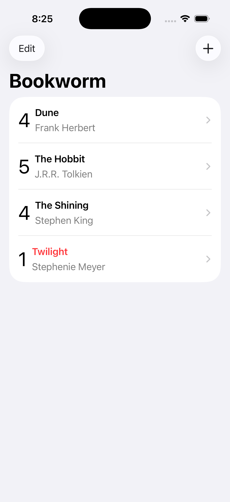
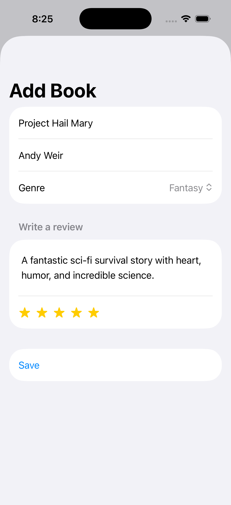
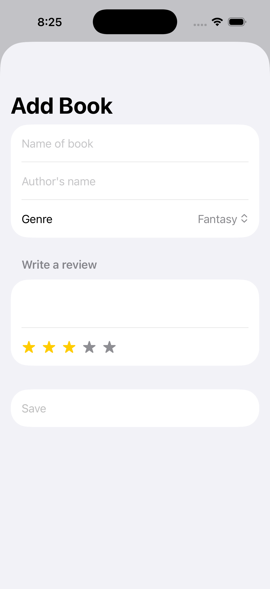
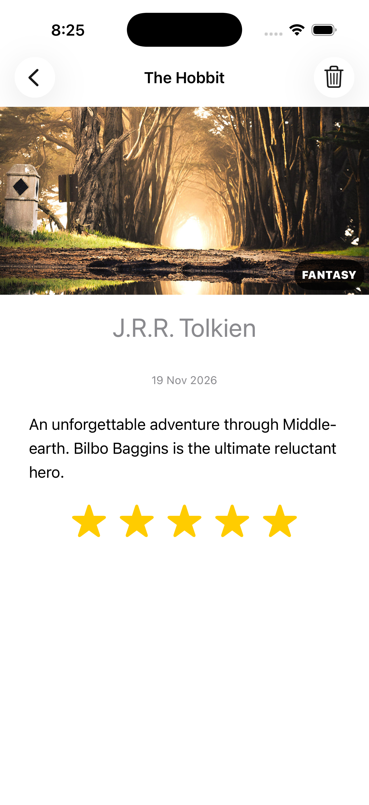

# Bookworm 📚

[](https://developer.apple.com/ios/)
[](https://swift.org/)
[](https://developer.apple.com/xcode/swiftui/)
[](https://developer.apple.com/documentation/swiftdata)

A book-tracking iOS application built with modern **SwiftUI** and **SwiftData** to record books read, personal reviews, ratings, and genre tags.

Developed as part of Paul Hudson's **[100 Days of SwiftUI](https://www.hackingwithswift.com/100/swiftui/53)** (Project 11: Bookworm), including the complete solution for the [Bookworm Wrap-Up Challenges](https://www.hackingwithswift.com/books/ios-swiftui/bookworm-wrap-up).

---

## 🎯 Wrap-Up Challenges Completed

### 1. Form Validation & Safe Defaults
> *Right now it’s possible to select no title, author, or genre for books, which causes a problem for the detail view. Please fix this, either by forcing defaults, validating the form, or showing a default picture for unknown genres – you can choose.*

- **Implementation**:
  - Added a computed property `hasValidForm` in `AddBookView` that trims whitespaces and newlines from `title` and `author`.
  - The **Save** button is disabled (`.disabled(!hasValidForm)`) unless both a valid title and author have been entered.
  - Added safe fallback handling in `DetailView` for genre images and tags (`book.genre.isEmpty ? "Fantasy" : book.genre`).

### 2. Highlight 1-Star Books
> *Modify `ContentView` so that books rated as 1 star are highlighted somehow, such as having their name shown in red.*

- **Implementation**:
  - In `ContentView.swift`, modified the book title style dynamically:
    ```swift
    Text(book.title)
        .font(.headline)
        .foregroundStyle(book.rating == 1 ? .red : .primary)
    ```
  - Any book given a 1-star rating immediately displays its title in vibrant red in the library list to alert the reader.

### 3. Date Added Attribute
> *Add a new “date” attribute to the Book class, assigning `Date.now` to it so it gets the current date and time, then format that nicely somewhere in `DetailView`.*

- **Implementation**:
  - Added `var date: Date` to the `@Model class Book` with a default value of `.now`.
  - Nicely formatted the date in `DetailView.swift` using SwiftUI's formatted date style:
    ```swift
    Text(book.date, format: .dateTime.month().day().year())
        .font(.caption)
        .foregroundStyle(.secondary)
        .padding(.top, 2)
    ```

---

## 📱 App Previews

<p align="center">
  
  &nbsp;&nbsp;&nbsp;&nbsp;
  
  &nbsp;&nbsp;&nbsp;&nbsp;
  
  &nbsp;&nbsp;&nbsp;&nbsp;
  
</p>

<p align="center">
  <em>Library List (1-star title in red) &bull; Add Book Sheet &bull; Form Validation (Save disabled) &bull; Book Detail (Genre art, rating & date)</em>
</p>

---

## ✨ Features

- **SwiftData Persistence**: Leverages Swift's `@Model`, `@Query`, and `modelContext` for persistent storage of book records.
- **Custom Interactive Star Rating**: Reusable `RatingView` supporting custom symbols, colors, and tap interaction.
- **Emoji Rating Visuals**: Compact `EmojiRatingView` mapping 1–5 star ratings to visual cues.
- **Genre Artwork**: Displays high-resolution genre artwork with uppercase overlaid badge in the detail screen.
- **Swipe-to-Delete**: Native list row deletion via `.onDelete(perform: deleteBooks)` and full alert confirmation in `DetailView`.
- **Sorting**: Automatic multi-descriptor sorting by title and author via `@Query(sort: [SortDescriptor(\Book.title), SortDescriptor(\Book.author)])`.

---

## 🏗️ Architecture & File Structure

```
Bookworm/
├── BookwormApp.swift       # Application entry point with .modelContainer(for: Book.self)
├── Book.swift              # SwiftData @Model schema with title, author, genre, review, rating, date
├── ContentView.swift       # Main library list with 1-star red highlight & swipe-to-delete
├── AddBookView.swift       # Form sheet with validation logic and genre picker
├── DetailView.swift        # Detailed presentation with genre image, formatted date, rating, delete alert
├── RatingView.swift        # Interactive 1–5 star rating component
├── EmojiRatingView.swift   # Compact emoji representation of rating
├── Assets.xcassets/        # Artwork assets for genres (Fantasy, Horror, Kids, Mystery, Poetry, Romance, Thriller)
└── screenshots/            # App screenshots showcasing all challenge features
```

---

## 🛠️ How to Build and Run

### Requirements
- **macOS Sonoma (14.0)** or later
- **Xcode 15.0+**
- **iOS 17.0+ Simulator** (or physical iOS device)

### Running in Xcode
1. Open `Bookworm.xcodeproj` in Xcode:
   ```bash
   open Bookworm.xcodeproj
   ```
2. Select your preferred iOS 17+ Simulator (e.g. **iPhone 17 Pro**).
3. Press **Cmd + R** to build and run.
